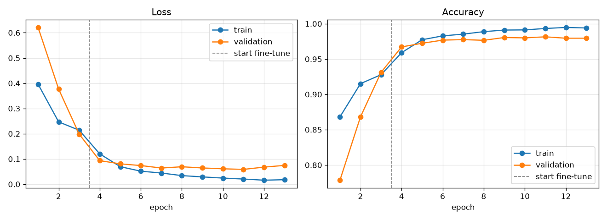
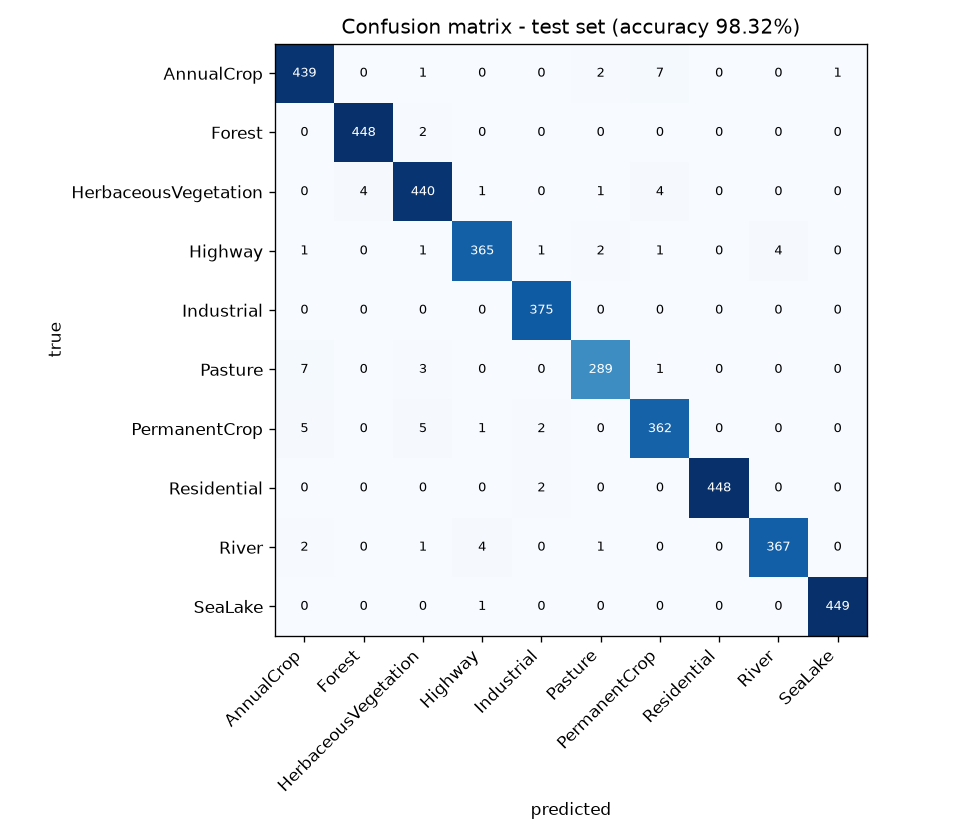

# Satellite Land-Use Classifier

Classifies 64×64 Sentinel-2 satellite tiles into 10 land-use classes with a fine-tuned **MobileNetV3-Small**.
It reaches **98.32% accuracy on an unseen test set**. A static web demo runs the model in the browser with ONNX.

**Live demo:** https://satellite-landuse-classifier.onrender.com

## Problem
The task is image classification. Given a satellite image tile, the model predicts what the land is used for: AnnualCrop, Forest, HerbaceousVegetation, Highway, Industrial, Pasture, PermanentCrop, Residential, River or SeaLake. Classifiers like this are used for land-cover mapping, monitoring urban growth and agriculture statistics.

## Dataset
**EuroSAT (RGB)**: 27,000 labelled 64×64 RGB tiles from Sentinel-2, covering 34 European countries, with 2,000–3,000 images per class. It is loaded with `torchvision.datasets.EuroSAT`, which downloads it automatically.

> P. Helber, B. Bischke, A. Dengel, D. Borth. *EuroSAT: A Novel Dataset and Deep Learning Benchmark for Land Use and Land Cover Classification.* IEEE Journal of Selected Topics in Applied Earth Observations and Remote Sensing, 2019.

The data is split **70 / 15 / 15** with stratification (seed 42), giving 18,900 train, 4,050 validation and 4,050 test images. The test set is only used once, after training.

## Architecture
- **Backbone:** MobileNetV3-Small pretrained on ImageNet (torchvision), about 1.5M parameters. It uses depthwise-separable convolutions, squeeze-and-excitation blocks and hard-swish activations, so it is small and fast enough to run in a browser.
- **Head:** the original 1000-class output layer is replaced by `Linear(1024 → 10)`. The rest of the classifier (Linear 576→1024, Hardswish, Dropout) is kept.
- **Export:** ONNX (opset 17). The file is 6.1 MB, and its outputs match PyTorch to within 3e-3.

## Training decisions
| Decision | Why |
|---|---|
| Transfer learning from ImageNet | The low-level features (edges, textures) carry over well to satellite images, so the model converges in a few epochs. |
| Resize 64 → 224, ImageNet normalisation | This matches the input the pretrained backbone was trained on. |
| Random horizontal + vertical flips | Satellite tiles have no fixed "up", so flipped images are still realistic. |
| **Stage 1:** frozen backbone, train the head only (3 epochs, LR 1e-3) | The new random head can learn without its large early gradients damaging the pretrained features. |
| **Stage 2:** unfreeze all layers (up to 10 epochs, LR 1e-4) | Fine-tuning the whole network adapts the features to satellite images. The 10× lower LR keeps the changes small. |
| AdamW (weight decay 1e-4), batch 64, cross-entropy | A standard, reliable setup. |
| Early stopping (patience 3) + best checkpoint on validation loss | Stops overfitting. The final model is the epoch with the lowest validation loss. |

The full run takes about 5 minutes on an RTX 5060 Laptop GPU and will also work on CPU, only slower.

## Results (unseen test set, 4,050 images)
| Metric | Value |
|---|---|
| Accuracy | **98.32%** |
| Macro F1 | **0.9826** |

| Class | Precision | Recall | F1 |
|---|---|---|---|
| AnnualCrop | 0.967 | 0.976 | 0.971 |
| Forest | 0.991 | 0.996 | 0.993 |
| HerbaceousVegetation | 0.971 | 0.978 | 0.975 |
| Highway | 0.981 | 0.973 | 0.977 |
| Industrial | 0.987 | 1.000 | 0.993 |
| Pasture | 0.980 | 0.963 | 0.971 |
| PermanentCrop | 0.965 | 0.965 | 0.965 |
| Residential | 1.000 | 0.996 | 0.998 |
| River | 0.989 | 0.979 | 0.984 |
| SeaLake | 0.998 | 0.998 | 0.998 |




Head-only training already reaches about 93% validation accuracy. Full fine-tuning raises it to about 98%. Validation loss bottoms out at fine-tune epoch 8 (the saved checkpoint), and after that the model starts to overfit slightly. The full numbers are in `reports/metrics.json`.

## Limitations
- The model was trained only on **European Sentinel-2 RGB** tiles at about 10 m/pixel. Images from other sensors, zoom levels, seasons or continents may be misclassified (domain shift).
- It **always picks one of 10 classes** and has no "unknown" option, so it is confidently wrong on unrelated images.
- It uses **RGB only**. EuroSAT also provides 13 multispectral bands, which separate vegetation types better.
- Most errors come from visually similar classes: AnnualCrop vs. PermanentCrop/Pasture, and Highway vs. River.
- The test set comes from the same dataset as the training data, so accuracy in real-world use will probably be lower.
- Results come from a single seed and split. There is no cross-validation and no confidence intervals.

## How to run
```bash
python -m venv .venv
.venv\Scripts\activate          # Windows  (Linux/macOS: source .venv/bin/activate)
pip install -r requirements.txt # CUDA 12.8 wheels; remove the --extra-index-url line for CPU-only
python train.py
```
`train.py` does everything: it downloads the data, trains both stages, evaluates on the test set, saves `reports/` (figures + `metrics.json`), exports `web/model.onnx` and copies the figures and sample tiles into `web/`.

To view the demo locally, serve the folder (opening the file directly from disk won't work, because the page must fetch the model over HTTP):
```bash
python -m http.server 8000 -d web   # then open http://localhost:8000
```

### Deploy (Render Static Site)
- Build command: *(leave empty)*
- Publish directory: `web`

## Project structure
```
train.py          # data -> train -> evaluate -> figures -> ONNX -> web assets
web/              # index.html, model.onnx, meta.json, figures, samples/
reports/          # training_curves.png, confusion_matrix.png, metrics.json
requirements.txt
screenshots/
```
